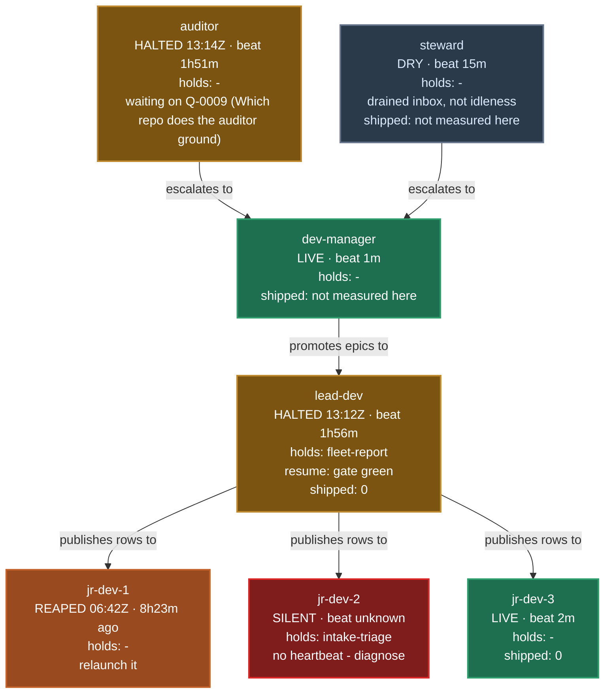

# report

You are producing **one fleet report**. It is the answer to "what is going on" **in a form that is
the same shape every time, so it can be skimmed rather than read.**

Without it, the picture is reassembled by hand out of the whole registry on every pass: correct
every time, and it costs a read of the whole file every time. Worse, the picture then exists only
*inside* a dev-manager session — the human has no way to ask "what is going on" without starting
one. The report answers both halves.

## Non-goals — read these before you read anything else

- **The report NEVER acts.** No labelling, no promoting, no reaping, no notes. It is a pure read.
  "Anything that both reports and mutates will eventually be run for its side effect."
- **It does not replace the dev-manager §1d digest.** The digest is an interrupt when something
  changes; the report is a scheduled full picture. Different jobs, different cadences.

**The only two things a report run writes are its own bookkeeping:** the archived vault page
(Step 5b) and `last_report_at` in the dev-manager state file (Step 9). Nothing it writes touches
the registry, a spec, an issue, a label, a lock or a branch. `agentflow.fleet_report` itself writes
nothing at all — the suite fingerprints the data root before and after a collection and fails on
any byte that moved, so a write added to the collector fails the suite rather than surprising a
reader.

The **reply verbs** (Step 6) are a different mode. They are human-driven dispositions that happen
*after* a report, and they write back only through the normal mediated CLI paths. A report on its
own changes nothing.

## Step 0 — resolve WHICH project, before anything else

Every `<name>` and `<data_root>` token below resolves from what you bind here. `$ARGUMENTS` may
carry `--project <name>`; strip it and bind from that call's stdout:

```bash
python -m agentflow.config show --project <name>
```

That output **beats** the SessionStart-injected block for the rest of the run — the injected block
is a session default, the argument is this run's instruction. A non-zero exit is a loud config
error: say which project failed to resolve and stop. Do not silently fall back.

With no argument, the injected session default is already correct.

## Step 1 — ONE data pass

Compute once, render three times. **They must never diverge** — "a chat report, a push and an
archive that disagree are worse than any one alone." So there is exactly one collection, and every
rendering formats *that object* and nothing else. **No renderer re-reads the registry, re-runs the
survey, or re-lists issues.**

```python
from datetime import datetime, timezone
from agentflow import fleet_report

inputs = fleet_report.inputs_from_config("<name>")
report = fleet_report.collect(inputs, now=datetime.now(timezone.utc))
```

(`agentflow.fleet_report` lives in `<suite_root>/skills/_shared/agentflow/`. It has no CLI — it is imported.
It reuses `epic_survey`, `registry` and `issue_intake` rather than re-reading their files, and
modifies none of them.)

Facts about the object you now hold:

- `report.sections()` yields `(name, section)` in the **locked order**, every section present.
- `report.changed_since` is the diff against the last archived report — see Step 5b.
- `report.archive` says where this report is to be filed, resolved **from config**, never from a
  hardcoded path. When the environment has no `vault` block, `archive.available` is `False` and
  the report still renders; you say the archive was skipped. A missing vault costs the diff, not
  the report.
- `report.registry_available` / `report.intake.available` are `False` with a `reason` when a
  source could not be read. **Render the reason.** A report that silently prints `0` for an
  unreachable tracker is worse than one that says it could not look.
  `report.unread_work_sources` names each source that exists and could not be read;
  `intake.tracker_configured` is `False` when the project has no tracker at all, which is an
  absent source rather than an unread one.

`rows_per_section` defaults to **10** — list sections render that many rows and a truncated
section says `showing 10 of N` (`Rows.showing` gives you the string). Pass
`inputs_from_config("<name>", rows_per_section=N)` only when the human asks for a longer report
*this run*. Do not invent a config key for it; the collector takes it as an argument. **A negative
value collects UNCAPPED** — that is the seam the walk verbs in Step 6 use, and nothing else.

**Ordering is per section, not one rule.** Print rows in the order the collector handed them to
you; do not re-sort. Reading a stale INTAKE row as "the lowest-priority one" is the failure this
paragraph prevents:

| section | order |
|---|---|
| BLOCKED — questions | **oldest first** (Step 6 depends on it) |
| BLOCKED — blockers | by registry row id |
| DECIDED | most recently answered first |
| INTAKE | tracker order (`gh issue list`), which is neither priority nor age |
| WORK, HEALTH inert list | **priority, lowest first**, slug as the tie-break |
| HEALTH — directives | registry order, which is the order they were laid down |
| LANES | agent name |

### The fields each section carries

`report.sections()` gives you the section objects; these are the fields to render. A section
rendered by improvising from `dir()` drops rows the spec locks — the human-owned Blockers, for
instance, which are the second half of the section that comes first.

| section | render |
|---|---|
| `blocked` | `.questions` (each `.qid .subject .age .urgency .raised_by .question`), `.blockers` (each `.bid .subject .owner .work .description`), **`.stranded` whenever non-empty** (each `.agent .waiting_on_label .reason .fix`), `.drafted_awaiting_promotion` + `.drafted_slugs`, `.scan` |
| `decided` | `.questions` (each `.qid .subject .question .answer .answered_by .answered_at`), `.windowed`, `.window_start`, **`.partial_note` whenever non-empty** (the window was not read whole; with no rows it replaces the empty-section line) |
| `intake` | `.available` + `.reason`, **`.untriaged_count` AND `.selectable_count` together** (+ `.selectable_note` beside them whenever non-empty: the count is label-only), `.fix_claimed_count` beside them (open issues a merged PR or done spec claims fixed; print `.fix_claims_note` whenever it is non-empty, in place of the number when the count is `None`), `.untriaged`, `.selectable`, **`.awaiting_count` + `.awaiting` whenever non-zero** (bugs labelled `needs-decision`: a human call is owed before they are build work), `.capped` (+ `.limit`) |
| `work` | **`.approved_claimable` AND `.claimable_now` together**, `.in_progress` (each `.slug .eta .lane`), `.parked_count`, **`.published_unclaimed` whenever non-empty** (each `.name .lane .kind`), **`.claim_ambiguous` + `.claim_note` whenever non-empty**, `.drafted_count`, `.shipped` + `.shipped_note`, `.scan`, **`.seam_blocked` AND `.seam_unknown_count` together**, `.seam_unknown_holders`, `.seam_partial`, `.seam_note` |
| `lanes` | `.lanes` (Step 7), `.live_count .halted_count .reaped_count .silent_count **.dry_count .blocked_count .stood_down_count**`, **`.production_available` + `.production_window` + `.production_unattributed`** (Step 7) |
| `health` | `.inert_promotions` (each with its `.reason`) + `.inert_count`, `.out_of_vocabulary` + `.out_of_vocabulary_count`, `.deploy_lock`, `.directives` + `.directive_count`, `.registry_bytes`, **`.notes_live`/`.notes_struck` (Step 7a)**, `.halt_events`, `.reap_events`, `.worktrees`, `.branches`, `.scan` |
| `counted_skipped` | `.scans` (each `str(scan)`), `.skips`, `.is_warning` |

`Rows`-typed fields carry `.showing`. The plain tuples — `blocked.drafted_slugs`,
`health.halt_events`, `health.reap_events`, `health.worktrees.directories` / `.unclaimed` /
`.unregistered` / `.missing`,
`health.branches.branches` — are **complete and uncapped**: there is no `showing N of M` for them
because nothing truncated them. If you shorten one for space, say so in that line yourself.

**`health.worktrees` answers TWO different questions and you print both or neither.**
`.unclaimed` asks whether any lane says it is working in a directory. `.unregistered` and
`.missing` ask whether git knows the worktree exists at all, which is a separate fact: the
steward enumerates with `git worktree list`, so a directory git never registered is reported by
nothing else and the sweep reads clean however many accumulate.

**The two registration directions are never one number.** An unregistered directory is a shell
`git worktree remove` cannot take, because that command fails on a path git has no registration
for. A registration whose directory is gone is the opposite, and `git worktree prune` is what
clears it. Merged into one count, a reader runs the wrong command half the time.

**When `.registration_note` is non-empty, print it and do not print the two registration tuples
as zeros.** It carries why the git side could not be read. The filesystem half still landed, and a
report that says nothing because one of its two probes failed is how a sweep goes quiet at exactly
the moment it has something to say.

**`health.open_prs` is the "finished but never landed" reader, and it carries parts rather than a
verdict.** It is the mirror image of the case the stale-row sweep watches: a pull request can sit
mergeable with every check green, untouched since it opened, while its lane's row still reads
`building` and the whole merge stream stands still behind it.

**Every other detector can be individually correct and silent on that case.** The missed-wake
alarm needs a lapsed deadline, and the lane's can be hours away. The stale sweep needs a
three-hour heartbeat, and the stall can sit well under it. The strand check needs an observed
halt, and the row reads `building`. The merged-PR rule needs the pull request to have merged, and
it has not. The signal is the **conjunction**, which is why no single-cell detector can produce it.

**Print each one's age, idle time, mergeable state, check rollup and the lane whose row owns its
branch.** A pull request no row claims prints an empty lane, and that is its own finding: nobody's
board says that work exists.

**There is deliberately NO threshold here, and you should not add one when rendering.** Twenty
idle minutes is normal, two hours is not, and the line between them is a judgement with an owner.
The report states the measurements; the reader judges. This is the same posture the worktree and
branch drift fields already take.

**`.checks` is empty for a pull request with no checks, and that is not `0/0 SUCCESS`.** A pull
request whose checks never ran is not one whose checks passed, and a vacuous green is what makes an
unverified change look ready to land.

**`health.open_prs` IS capped, unlike the tuples above, and `open_prs_note` is where it says so.**
The note carries either why the tracker could not be read, or that the list hit its limit. gh
returns newest-first, so a full page means the rows that fell off are the OLDEST - the stalled
ones this signal exists to find. Print the note whenever it is non-empty.

**When `health.open_prs_note` is non-empty, print it and do not print an empty list.** It carries
why the tracker could not be read. An empty list because nothing is stuck and an empty list because
nobody looked are the same on the page, and only one of them is good news.

## Step 2 — the section order is LOCKED, and empty sections stay

1. **BLOCKED ON YOU** · 2. **DECIDED BY AGENTS** · 3. **INTAKE** · 4. **WORK** · 5. **DONE** ·
6. **LANES** · 7. **HEALTH** · 8. **COUNTED / SKIPPED**

Asks first, then what the fleet decided without you, then the queues, then machine state.

**The lock is EIGHT.** The rule exists so the order does not change casually, not so it can never
be revised - DONE sits at 5, between WORK and LANES, because it reads as the natural other half of WORK and answers the question a
status board is most often opened for.

**DONE and WORK's SHIPPED are DIFFERENT READINGS and both are true.** WORK's comes from the
snapshot diff, so it can only ever show what moved since the LAST report - on a ten-minute cadence
that is almost always empty while ten things shipped that day. DONE reads merged pull requests over
a window. Render `report.done.source_note` verbatim: a reader seeing `0 shipped` beside six merged
rows is not looking at a contradiction, and the note is what makes that legible rather than
alarming. When `report.done.available` is False, print `report.done.reason` - a section that
silently prints nothing for an unreachable tracker is worse than one that says it could not look.

**Sections stay present when empty.** "An empty section reads as 'checked, nothing there'; an
absent one is indistinguishable from a section that failed to run." Render the heading and one
short line — `no open questions`, `nothing shipped in this window` — never drop the heading, never
reorder, never slot a new section between two of these. Iterate `report.sections()` so the order
cannot drift between the artifact, the vault page and the push.

## Step 2a — WORK renders BUGS beside EPICS, in the same four states

**Extend WORK; never add a ninth section.** The order above is locked at eight. Bugs are straightforwardly work, and they belong in the section named
WORK.

Bugs reach builders - `builder_selectable` is `triaged`, not `epic`, not `needs-decision`, not
`in-progress`, and not held on the board, lead-dev picks from it - but without this a reader sees
`20 untriaged / 3 selectable` in INTAKE and still not *"three bugs are being worked right now"*.
INTAKE counts what is waiting at the door; WORK shows what is being carried. INTAKE's selectable
is the same set the `selectable` CLI prints and `work.bug_claimable` holds, over the same board.
When the registry was not read, no held set was subtracted: `intake.selectable_note` then says the
count is label-only, and is printed beside it.

The four bug columns mirror the four epic states one for one, so the two read as one table rather
than a table with an appendix:

| epic state | bug field | means |
|---|---|---|
| claimable | `work.bug_claimable` | `triaged`, not `epic`, not `needs-decision`, not held - the set `issue_intake selectable` prints |
| in progress | `work.bug_in_progress` | held: published to a lane or being built - a `gh#N` in the work item of a non-terminal Queue row or in an Agents row, or the issue carrying `in-progress` |
| drafted | `work.bug_untriaged_count` | exists, cannot start yet |
| shipped | `work.bug_shipped` | closed since the last report |

**`work.bug_in_progress` is the held set, and the board is the gate.** An issue is held when its
`gh#N` appears in the work item of a Queue row that is not `done` or `withdrawn` - claimed or
still `ready`, because a published row has already handed its work out - or in an Agents row.
Notes do not count. `issue_intake.held_refs` defines this once, and the `selectable` CLI, the bug
mirror and this column all read it, so the three cannot disagree: a held bug is off the build
list and still visible here. The `in-progress` marker on the issue is honoured beside it, but no
loop runs `claim`/`release`, so nothing writes it on its own; lead-dev's own publish is what
takes an issue off the list.

**When `work.bug_note` is non-empty, print it and do not print zeros.** It carries INTAKE's reason
- an unreachable tracker, no tracker configured - and *"no open bugs"* is a different fact from
*"we could not look"*. INTAKE already refuses to conflate those two; WORK must not undo that one
section later.

**When the registry could not be read, `work.bug_claimable` is empty and the selectable bugs are in
`work.bug_claim_ambiguous` instead.** Only the `in-progress` marker was checked, so a bug held on
the board alone cannot be told from a free one. `work.bug_note` says so; print
the list beside it, as `claim_ambiguous` is printed for epics.

## Step 2b — WORK must NAME the no-work condition

**When `report.no_work_anywhere` is true, WORK prints the no-work sentence.** Not three zeros,
and not a zero next to a count — the sentence. Print `report.work_sentence`, which is
`FleetReport.NO_WORK_SENTENCE`, or `FleetReport.NO_WORK_SENTENCE_NO_TRACKER` for a project with no
tracker, so the sentence never points at a source that does not exist.

**Why this is a requirement rather than a nicety.** `lead-dev` does not halt on an empty queue. It
idles, and its only signal is a one-off notification-only ntfy that scrolls away, so no durable
surface says the product has run out of work. **The report is that channel.** Without the sentence a reader has to combine three zeros — claimable 0, drafted 0, nothing selectable — and infer
"the product has no work anywhere". That inference is exactly the sort this report exists to stop
people making by hand, and nobody makes it at a glance on a phone.

Read the property; do not re-derive the three terms here. It is deliberately **not**
`work.is_empty`, which also reads `shipped` — a day on which something shipped but no work remains
is precisely the day that matters, and `is_empty` answers False for it.

It is a rare condition, which is why it must be unmissable when it occurs rather than
reconstructed from an absence.

**Zeros are not always no work, and `report.work_sentence` says when they are not.** Print it
whenever it is non-empty. It carries either or both of two other sentences, and the predicate stays
false for both:

- **Could not determine.** A configured tracker or the registry could not be read
  (`report.unread_work_sources`). Zeros over a source nobody looked at are the absence of a look,
  and the no-work sentence must not rest on them.
- **Inert approved epics.** Every other count is zero but approved epics exist that no builder can
  dispatch. The sentence names them; HEALTH gives each one's `.reason` (an out-of-vocabulary
  `queue_class`, a known but non-dispatchable one, or an excluded domain). One frontmatter fix makes
  each claimable, so the next action is that fix, not new work.

## Step 2c — WORK says how much of itself a free lane could actually START

**Print `claimable`, `seam-blocked` and `seam-unknown` together, or print none of them.** The
same pairing rule INTAKE already lives by: *"3 claimable"* and *"0 a free lane can start"* are
the same number to a reader who is given only the first.

**`work.approved_claimable` and `work.claimable_now` are the same pair one step earlier, and the
same rule binds them: print both or print neither.** `approved_claimable` counts every approved
epic in the corpus; `claimable_now` counts the ones no lane has already taken. A reader shown only
the first reads a board with eight approved epics as a board with eight epics free, on a morning
when six are claimed and two are being built: the number that says *plenty of work* and the
number that says *nothing a free lane can start* are different numbers, which is why Step 2b's
no-work sentence keys on `claimable_now` and never on `approved_claimable`: a sentence that read
the first would say *plenty of work* on a morning when no free lane can start anything.

**A claim is a claim wherever it is recorded.** An epic is in flight when a lane's `## Agents` row
names it OR a non-terminal `## Queue` row carries a `claimed_by`, not only when a lane says it is
`building`. A terminal queue row (`done`, `withdrawn`) is provenance, not a claim, and never holds
an epic out of `claimable_now`.

**`work.parked_count` is a third state and folds into neither number.** A parked row is claimed —
so it is not claimable now — but nobody is building it, so calling it in-flight overstates the
board. Print it as its own count. A parked epic that disappears into an in-flight total is how a
stall stays invisible for a week: the work looks live, and no one goes looking for the reason it
stopped.

**`work.published_unclaimed` is the state beside it, for epics and bugs alike.** A `ready`
Queue row whose `claimed_by` is `-` has published its work into one builder's lane, and only that
lane's owner may take it. It is not claimable now (lead-dev can neither select nor republish it),
and nobody is building it yet: it is out of `claimable_now` and `work.bug_claimable`, and
lead-dev's LANES why never counts it as startable. An epic row folds into neither number; a bug
row is also in `work.bug_in_progress`, whose held set is "published to a lane or being built".
Print each row with its `.lane`. The no-work sentence stays silent while this is non-empty,
because work waiting in a lane is not an empty board. A published row whose id names more than one approved epic lands in
`claim_ambiguous` instead, by the same rule a claim follows.

**WORK's bug totals count every selectable bug, not the rows INTAKE rendered.** `.total` on each
bug field is the whole count, and `.showing` says when the rendered rows are fewer; print it.
`work.seam_partial` is then true, because the seam check saw only the rendered rows.

**`work.claim_ambiguous` is a fourth state, and it is the one you must never print as a zero you
did not check.** An epic id carries only the first four hyphen-tokens of its slug, and that name is
not unique — collisions are common, most of them a slug beside the same slug with a suffix. When a claim's name matches more than one approved epic and nothing
separates them, the report cannot say which one is held. It names all the candidates here, keeps
them out of `claimable_now`, and says so.

**When the registry could not be read, every approved epic lands in `claim_ambiguous`** and
`work.claim_note` says why. No claim was checked, so any of them may be held, and a `claimable_now`
printed as if the check ran would invite a lane into occupied work. Print the note beside the list.

**When `claim_ambiguous` is non-empty, print it beside `claimable_now` and do not print the no-work
sentence.** The predicate is suppressed at the source for exactly this reason: `claimable_now == 0`
is not evidence of an empty board when a claim could not be resolved. A stall that goes unreported
costs a wake. A stall reported falsely stops the foreman, and with it every lane the foreman feeds.

| field | means |
|---|---|
| `work.seam_blocked` | claimable items whose declared files intersect an in-flight item's — each carries `.name`, `.blocked_by` and the offending `.paths` |
| `work.seam_unknown_count` | claimable items whose file set could not be read at all |
| `work.seam_unknown_holders` | in-flight items that declare no files |
| `work.seam_partial` | the row lists were capped before the check saw them |
| `work.seam_note` | why a clear verdict is weaker than it looks, when it is |

**Render `.blocked_by` and `.paths`, not just the count.** A count says the board is stuck; the
holder and the path say what to wait for, and a reader who cannot see those has to go and
re-derive by hand the thing this signal exists to save them.

**`seam_unknown_count` is a third state and never merges into either column.** An item with no
`## Files` section has not told you it touches nothing — it has told you nothing. Counting it as
claimable is precisely how a blocked lane reads as an available one.

**When `work.seam_note` is non-empty, print it beside the zero it qualifies.** It fires when
in-flight work declares no files, or when `rows_per_section` capped a list before the check saw
it — both mean every *not blocked* verdict in the section rests on a partial view. A silent zero
there is worse than no signal at all, and the cap is the COMMON case rather than the corner one:
the default is 10 rows.

**This is REPORTED, NEVER ENFORCED, and the distinction is deliberate.** Nothing here relaxes
seam disjointness or lets a lane build into an occupied seam: builders sharing one seam produce
merge conflicts even with worktrees. The rule is right; this gives it a channel.

**The signal UNDER-reports by construction.** Paths match as exact strings, so a directory named
on one side and a file inside it on the other do not intersect. Do not present it as exhaustive:
a missed overlap costs one bounced claim, while a fabricated one would park real work behind
nothing.

## Step 3 — SLUGS, NEVER NUMBERS

Every human-facing surface names epics by **slug**. Not `E-NNNN`, not a priority integer.

**This is baked into agentflow, not configured.** "EVERY user of agentflow will have the same need
to see slug names vs numbers. There's simply too many epic numbers to remember, especially when the
fleet is moving fast." It binds this skill hardest, because the report *is* the human-facing
surface.

Numbers still belong where they are the real identifier: **tracker issues** (`#51`), **registry row
ids** (`Q-0009`, `B-0001`), **commits and PRs**. Those have no slug. Epics have one — use it. The
collector already enforces this in its row types; do not reintroduce a number when you render.

**But a bare number is unreadable whether or not it is the correct identifier.** Being the
identifier earns a number its place; it does not excuse it from carrying a name. The general form:
*the identifier and the human-readable name are different jobs, and a surface a human reads needs
both.* So:

- **Tracker issues: `#N` AND the issue title**, everywhere the report prints one — INTAKE's
  untriaged, selectable and awaiting-a-decision lists (the rows are `issue_intake.Issue` objects
  carrying `.title`) and CHANGED SINCE's triaged numbers (`str(report.changed_since.named(n))`).
- **Registry ids: the `Q-` / `B-` id plus a 3-6 word subject** (shorter only when the question
  itself is) — `Q-0009 (Which repo does the auditor ground)`, never a bare `Q-0009`. The
  collector derives the subject from the row's own text, its first words, and hands it over
  beside the id: `QuestionRow.subject`, `BlockerRow.subject`, `DecidedRow.subject`,
  `report.changed_since.named(qid)` for CHANGED SINCE, `LaneRow.resume_label` plus the
  why-string for a halted lane, and `StrandedLaneRow.waiting_on_label` for BLOCKED ON YOU. Print what it gives you; do not
  write a subject of your own. When the id is not on the board the collector says so in words —
  `Q-0042 (no subject: not on the board)` — and that marker is printed as it is, never trimmed
  back to the bare id.
- **Commits and PRs: the sha or the number alone.** Here the number IS the identifier and no name
  exists to pair with it.
- **The Ntfy push is the one shorter form**: the lead id carries its subject and the tail of the
  list rides as bare ids, because the push is length-sensitive and is a pointer into the report,
  not the record (Step 5c).

## Step 4 — THE HARD RULE: never report a count without its skip count

`survey_epics()` silently skips unparseable files and logs a line no caller can capture, so every
count taken through it is quietly partial. **A report is
exactly the artefact that turns a partial count into a confident-looking fact.**

- Print **`counted N, skipped M`** wherever a number came from a scan. `str(scan)` on any
  `ScanCount` gives you that string. Four carriers, and the list is exhaustive:
  `report.work.scan`, `report.blocked.scan`, `report.health.scan` (its inert and
  out-of-vocabulary counts come from the same survey) and `report.counted_skipped.scans`, which
  holds **both** the epic survey's scan and the **registry's** — a large file whose parser drops
  a row with the wrong cell count, an unknown agent name or a malformed id, in silence.
- **INTAKE's pair is a scan-derived number too.** `report.intake.capped` is `True` when the
  tracker page came back exactly full; say so beside the pair rather than printing it as a
  complete count.
- **A non-zero skip renders as a WARNING, not a footnote.** Top of the report, not the bottom.
  `report.counted_skipped.is_warning` is the test.
- **Name every skipped file.** `report.counted_skipped.skips` is deliberately not capped by
  `rows_per_section`; do not cap it yourself. A truncated list of what the report could not see
  recreates the exact defect this rule exists to close.

"A report that cannot say what it missed is indistinguishable from a report that missed nothing."

## Step 5 — THREE renderings, ONE data pass

| rendering | what | why |
|---|---|---|
| **Artifact** | the full visual report — lanes chart, tables, health | Mermaid renders natively in artifacts; in a terminal it is raw source and unreadable. This is the human-facing report. |
| **Vault page** | one permanent markdown file per report | Reportability, transparency, and — the load-bearing reason — **it makes the next report a diff instead of a guess.** |
| **Ntfy** | blocked-first, one fact per line, **ASCII-only**, no tables | The push. Ends with the single next action. |

**Chat gets the artifact LINK plus the headline, never the whole report pasted — the reader is
usually on mobile.**

### 5a. The artifact — the full report

Load `artifact-design` first (the Artifact tool requires it), then publish the page.

- All eight sections, in the locked order, empty ones included.
- **CHANGED SINCE** goes directly under the title, above BLOCKED ON YOU. Render
  `report.changed_since.note` verbatim when it is set: with no prior it says
  **"first report - no prior to diff"** and you must not silently render the whole corpus as new;
  when nothing moved it says **"nothing changed since <stamp>"**, which is a real and useful
  sentence the report can now *demonstrate* rather than assert. It can also carry a
  **"window partial: ..."** sentence beside a non-empty section, when part of the window could
  not be read (for example an unreadable `registry-log.md`); render that too, never drop it.
- **Every question id and triaged issue number in CHANGED SINCE prints as
  `str(report.changed_since.named(x))`** — `Q-0012 (Which repo should the auditor ground)`,
  `#51 (report omits archived epics)`. The id tuples stay bare because the next report diffs
  against them; the names ride beside them in `changed_since.names` (Step 3).
- **`changed_since.questions_retracted` gets its own line, never folded into "answered".** A
  retraction is a question its RAISER withdrew because the premise collapsed; nothing was
  decided. Rendered as an answer it would credit a decision nobody made, and omitted entirely the
  row just vanishes between two reports.
- A non-zero skip count is a warning banner near the top, per Step 4.
- **BLOCKED's question ages are colour-coded**, oldest first. Three bands, mirroring the reap's
  own 24h ageing rule so the report has one notion of "recent": under 24h neutral, 24h–72h amber,
  over 72h red. `QuestionRow.age` is the formatted string and `.age_hours` the number to band on;
  an `age` of `unknown` (an unreadable `raised_at`) is amber, never neutral.
- **LANES is a Mermaid diagram, not a table** — Step 7. The diagram *replaces* the table entirely;
  two renderings of the same six rows is noise.
- **Print the reply verbs (Step 6) ABOVE THE TITLE, as a compact bar.** They are the page's only
  interactive surface, and at the foot a reader on a phone reaches them only after scrolling
  the whole report. Step 6 argues for their prominence in its own words - *"a capability nobody knows about
  is not a capability"* - and that argument does not survive putting them last. Same four verbs,
  same wording; only the position changes.
- **The drafted-spec list is a two-column plain list, never pills.** Dozens of slugs rendered as
  bordered pills reflow into a ragged block that cannot be scanned. One slug per line, monospace, two
  columns, collapsing to one under ~640px. **The general rule:** pills are for a handful of short
  tokens (issue numbers); never for a long list of long identifiers.
- **One LIGHT theme, committed to deliberately.** This report is read in daylight, on a phone, at a
  glance. Carrying two half-tuned themes buys nothing here. Still paint `background` and every
  colour EXPLICITLY so the page holds on any host ground - a single-theme choice is not permission
  to inherit the host's.
- Keep the title and favicon stable across runs so the reader recognises the tab.

If the running client has no Artifact tool, say so in one line and hand over the vault path
instead. **Do not fall back to pasting the whole report into chat** — that is the failure mode the
split exists to prevent.

### 5b. The vault page — the archive is the feature, not the filing

One permanent markdown file per report, named so they sort chronologically:

```python
info = report.archive   # .available / .reason / .directory / .filename / .path / .prior_path
```

**Write to `info.path`, verbatim.** Do not assemble a path out of `<vault.root>` and any other
field: `info.path` is the same value `find_latest_archive` reads back on the next run, and a
writer path that differs from the reader path by even one component is silent forever — every run
writes where no run looks, `changed_since` says "first report - no prior to diff" on run 1, run 2
and run N, the SHIPPED table never exists, and nothing errors. The location comes from the config
`vault` block via `inputs_from_config`, never from a path you type. When `info.available` is
`False`, skip the archive, print `info.reason`, and say plainly that the **next** report will have
no prior to diff.

**The page MUST embed `report.snapshot_fence()` verbatim.** That fenced block is the
machine-readable state the *next* run diffs against; re-parsing rendered prose to recover it would
turn every wording change into a silent diff regression. Never hand-write the fence, never edit an
archived page, never overwrite or append to an earlier one — one file per report is what makes the
window exact.

The archive buys three things the report cannot otherwise have:

1. **"Since the last report" becomes computable.** Sweeping the whole session for "shipped" is
   right once and wrong forever after. With report N-1 on disk the window is exact.
2. **The report can prove a quiet period.**
3. **A record of what was believed when** — so a claim is correctable against the record rather
   than against memory.

### 5c. The Ntfy push — blocked-first, ASCII-only

```python
from agentflow.ntfy import TriggerType, notify, to_ascii
```

- **Blocked-first.** The first line after the header is what is waiting on the human.
- **One fact per line. No tables. No Mermaid.** It is a push, not a page.
- **ASCII-only body.** Fold at the call site with `to_ascii(...)` — that is the guarantee, not a
  belt-and-braces. `notify` raises `NtfyAsciiError` on a surviving non-ASCII character *only*
  while `notify.ascii_only` is true; a project that sets it false has no backstop at all.
- **One line per fact, and a skip reason is one fact.** `SkippedFile.reason` is already folded to
  a single line by the collector; do not re-expand it.
- **It ends with the single next action** — one imperative line, not a list.
- **The lead id carries its subject; the tail rides as bare ids.** Name the one that blocks, as
  Step 3 says, and let the rest of the list be ids: three subjects push the next action off the
  end of the notification, and the report the push links to carries every subject.
- Prefix with the resolved `<name>` from Step 0, not the session default. A push naming the wrong
  fleet sends the human to the wrong registry.

**BLOCKED ON YOU also lists every lane halted on a dead referent** (`report.blocked.stranded`): a
question that is answered, applied or retracted, a blocker already resolved, an id that exists
nowhere, or no id at all. The classifier is the one behind `registry read --stranded`, so the two
never disagree. Nothing will ever answer such a lane, so it waits on you: print one row per lane
with `.agent`, `.waiting_on_label`, `.reason` and `.fix` (relaunch or apply for a closed referent, a new
question or a resume for a retracted one, repair for a missing id). The lane still counts as
HALTED in LANES, and its why-string names the same reason and fix. A lane halted on a live open
question is not listed here; its question already is.

Priority: send `TriggerType.ESCALATION` when BLOCKED ON YOU is non-empty **or** the skip count is
non-zero — those are the reports that ask for something. Otherwise `TriggerType.PHASE_COMPLETE`, so
a quiet report does not buzz like an alarm. Shape:

```
<name> fleet report 2026-09-01T14:20Z
blocked: 2 questions, oldest 3d1h - Q-0012 (Which repo should the auditor ground) Q-0015
intake: 20 untriaged / 0 selectable
work: 3 claimable, 1 running, 0 shipped since last report
lanes: 3 live, 2 dry, 1 blocked, 0 halted, 0 reaped, 1 silent, 0 stood down
skipped: 4 files the survey could not parse
next: answer Q-0012 (Which repo should the auditor ground)
```

### 5d. Chat — the link and the headline, nothing else

One short message: the artifact link, then a **one-line headline** built from the same object —
what is blocked, what is running, silent lane count, and the skip warning if there is one. Then the
reply verbs. That is the whole chat surface. The report lives in the artifact.

## Step 6 — the reply verbs (THE REPORT MUST PRINT THESE)

A capability nobody knows about is not a capability. Print this table on the artifact **and** in
chat, every run:

| reply | does |
|---|---|
| `work` | full WORK list in chat |
| `intake` | full INTAKE list, then walks untriaged issues **one at a time in STP format** |
| `decisions` | full DECIDED list in chat |
| `blockers` | walks open Questions **one at a time in STP format** for answering |

**"Full" means uncapped, and the object you hold is capped.** Every list section was cut to
`rows_per_section` and the remainder discarded, so a walk driven off `Rows.items` can never reach
issue 11 of 20 or the fifth of fifteen open Questions — which is exactly the "20 untriaged" case
the spec calls the signal. For all four verbs, collect once more with the cap off:

```python
full = fleet_report.collect(
    fleet_report.inputs_from_config("<name>", rows_per_section=-1),
    now=datetime.now(timezone.utc),
)
```

That does **not** break Step 1. The one-data-pass rule binds the three renderings of ONE report,
which must agree with each other; a reply verb is a separate interaction that happens after the
report has been rendered, and it needs the rows the report deliberately left out. Do not re-render
the report itself from this second collection.

`work` and `decisions` are plain listings. `blockers` and `intake` are **not just longer lists —
they are interactive dispositions.** `blockers` collects answers; `intake` collects triage calls.

**STP = Situation / Target / Proposal.**

- **Situation** — strictly what was measured. No inference, no blast-radius claim you did not
  observe.
- **Target** — what "solved" looks like, stated so the Proposal is *judgeable*.
- **Proposal** — a single recommended action. **Not a menu.**

**One item per turn; the next only after the human answers.** On mobile the two-turn rule still
holds: **STP prose in one turn, buttons only in a following turn** — see the `asking-questions`
skill; when the resolved config sets `question_style: mobile-two-turn`, a turn containing the
question tool call shows only the cards and same-turn prose is invisible.

**Both write back through the normal mediated paths, and neither bypasses a human-only
disposition:**

- `blockers` → walk `report.blocked.questions` (already ordered **oldest first** — this section
  answers "what has been waiting on me longest", so a fresh halted question never jumps a week-old
  one). Write each answer through the CLI, never by hand-editing the row:
  `python -m agentflow.registry answer --actor dev-manager --project <name> --id Q-NNNN --answer "..." --by human`.
  `--by human` is correct here: you are relaying the human's call, not exercising delegated
  authority. The **raiser** flips `answered -> applied` — never do that for them.
- `intake` → walk `report.intake.untriaged` and dispose per **dev-manager §3.4's contract table**,
  which is the locked decision set. Do not restate or extend it here. **A won't-fix, duplicate or
  premise-gone close stays human-only.** A fixed issue is the auditor's: its fixed-issue pass checks
  each ask on the base branch and closes it, and the seat that built the fix never does.

## Step 7a — HEALTH thresholds render as a line, not as a silence

`report.changed_since.health_crossings` is the only place a threshold reaches a human. **Render
every crossing**, each as `<metric>: <now> (threshold <threshold>) — <direction>`, in HEALTH.

- **Three directions, and they are not interchangeable.** `crossed` = it went over on THIS
  report (new, and the most urgent). `over` = it is still over (standing, and the reason this
  is a level report rather than an edge detector — under an edge-only rule a metric that never
  comes back down is silent forever). `cleared` = it came back under.
- **`note_backlog` is the one to read first when it is over.** Live coordination Notes are
  drained by every seat striking what it consumed, so a standing backlog is not a busy fleet —
  it is a channel nobody is reading, and every routed finding in it is unread.
- **Do not fold these into `changed_since.note`.** That field carries only the no-prior,
  nothing-changed and window-partial sentences, so on the reports where a crossing exists it is
  empty or about something else. A renderer that prints only `.note` prints nothing about health,
  forever.

## Step 7 — LANES renders as a diagram, not a table

Build a Mermaid flowchart from `report.lanes.lanes`. Locked semantics — these are decisions, not
styling preferences:

- **Topology is escalate-up, dispatch-down.** auditor and steward `escalate to` dev-manager;
  dev-manager `promotes epics to` lead-dev; lead-dev `publishes rows to` the juniors. This is true
  rather than decorative: dev-manager is the only human surface and nothing else asks a person
  directly. Because Mermaid ranks source above target, the escalating loops render ABOVE the hub —
  accepted deliberately, semantics over org-chart shape.
- **Fill carries state, node text carries the reason.** live / halted-by-design / reaped are three
  conditions with three different fixes; rendering them alike would erase the distinction. A halted
  lane needs its question answered, a reaped lane needs relaunching, a silent lane needs diagnosing
  before anything else is safe to do to it. `LaneRow.why` is never blank for a non-live lane — put
  it in the node.
- **Reaped ages out: burnt orange for the first 24h, grey after.** "Recent death is actionable; a
  week-old one is history and must stop competing for attention." `LaneRow.reaped_recent` picks the
  class.
- **A halted node prints `LaneRow.resume_label`, not `resume_condition`.** The label is the same
  `waiting_on` with a subject beside every `Q-` / `B-` id in it (Step 3); `resume_condition` is the
  raw cell, kept for machines. Free text such as `gate green` names no id and comes back unchanged.
- **Ages render in the node.** No separate table to cross-reference. `LaneRow.beat` is the
  formatted heartbeat age.
- **Report the silent count explicitly** — `report.lanes.silent_count`, in a line beside the
  diagram. "0 silent" is the reassuring half, and it only means something because the other
  categories exist beside it. Report `.dry_count` and `.blocked_count` in the same line: a seat with nothing to do
  is not a seat that is failing, and the two counts read very differently side by side. Report
  `.stood_down_count` there too: a lane a human stopped is counted nowhere else, and a paused fleet
  must read as paused rather than as a fleet with nothing live. All seven counts go on ONE line,
  in this order, and the Step 5c push carries the same line so the two never diverge:
  `lanes: 3 live, 2 dry, 1 blocked, 0 halted, 0 reaped, 1 silent, 0 stood down`.
- **PRODUCTION GOES IN THE NODE, BESIDE THE LIVENESS STAMP, AND IT IS NOT OPTIONAL.** Every
  other thing in this node answers *is it alive*. `LaneRow.merged_in_window` is the only one
  that answers *is it producing*, and a lane green on liveness and zero on production across
  several reports is the exact shape this field exists to catch. Render it as `shipped: N`.
  - **`None` is NOT zero and must never render as `0`.** It means the question could not be
    asked of this seat — the tracker was unreachable, or the seat does not ship pull requests
    at all. Render `LaneRow.production_basis` instead, which says which: it begins with
    `unmeasured:` in exactly that case. A `0` printed where the answer is "we did not look" is
    the same confident-wrong reading this section exists to remove.
  - **Say the window once, beside the diagram** — `report.lanes.production_window` — and print
    `report.lanes.production_unattributed` with it whenever it is non-zero. That count is the
    denominator: without it a reader cannot tell "this lane shipped nothing" from "the
    attribution key missed", and E- ids that two seats have held are deliberately dropped into
    it rather than guessed.
- **A DRY node prints `LaneRow.why` like any other non-live lane, verbatim.** The sentence
  differs by seat on purpose — a builder's lane is filled by lead-dev, so an empty one really
  does mean *publish work*, while a lane-less seat's empty inbox means it has DRAINED the
  channel and its own output is measured elsewhere. Paraphrasing them into one "needs work"
  line re-introduces the false remedy that string was written to remove.
- **A LIVE lead-dev node prints `LaneRow.why` when it is non-empty.** lead-dev selects from the
  claimable epics and bugs and publishes its pick into its own lane, so an empty lane beside
  startable work is a seat about to pick, not a dry one. Its `why` then counts what it can start
  (seam-blocked items excluded) or names the approved epics whose claim state is ambiguous.
  Every other LIVE row's `why` is blank.

Each node carries all four things the spec locks into a LANES row — **agent, state stamp, what it
holds (`LaneRow.work`), heartbeat age (`LaneRow.beat`)** — plus `LaneRow.why` on every non-live
lane:



**A `SILENT` lane must never fall through to the `live` fill.** Seven lane states, eight classes
(reaped splits on age). `DRY`, `BLOCKED` and `STOOD-DOWN` are states the collector emits and this
table had no fill for; a state with no class renders in the default grey-white, which reads as
neither alarming nor reassuring and is indistinguishable from a diagram that failed to style. The
DRY fill is deliberately cool and quiet: nothing is wrong with a dry lane.

**The topology above is the seven known loops. A registry row for anything else still gets a node** —
draw it unattached rather than dropping it, and say in the section that it is off the escalation
topology. A lane the report does not draw is a lane nobody looks at.

Escape the node text: `|` and `"` break a Mermaid label, and epic titles, issue titles,
registry subjects and `waiting_on` cells can carry them. Truncate `why` to one short clause — the
full text belongs in the section prose — but never cut inside an id's parenthesised subject or
marker: a halted node prints `resume_label` on its own line, whole, as the example node does.

**Pre-flight is mandatory.** Never embed unvalidated Mermaid:

```bash
python <suite_root>/scripts/validate_mermaid.py <draft.mmd>
```

Exit 0 before the fence ships. `<suite_root>` comes from Step 0's config output. If it fails,
fix and re-run **once**; if it fails a second time, render LANES as a plain per-lane list
(`agent - state - beat - why`) and say in the section that the diagram failed validation. Shipping
a broken fence is worse than shipping no fence.

## Step 8 — the one-line explainers the report must carry

A reader should never have to ask what a row means. Carry both of these, in-line, every run:

- **Directives in force** — "standing human instructions, re-read by every builder before any
  irreversible action". **Render the count with the directive names, not just a number**
  (`report.health.directives` carries the names).
- **Skipped** — "files the survey could not parse and silently ignored". **Always name them.**

## Step 9 — record that the report ran

Write two fields into `<data_root>/projects/<name>/status/dev-manager-state.md`, creating it if
missing. **The key names are the contract** — dev-manager §0.5 reads them back by name, and a
field written under a different spelling is a ceiling that never trips:

- `last_report_at:` — the ISO stamp in `report.generated_at`.
- `last_report_path:` — the archived page you wrote in Step 5b, or `skipped: <reason>` when
  `report.archive.available` was `False`.

This is what makes the 24h ceiling **checkable rather than guessed**, and what makes a stale report
visibly stale. A run that renders three ways and forgets this leaves the next session unable to
tell whether it is looking at fresh state or yesterday's.

## Triggers — three ways in, one output

1. **Automatically at the start of every dev-manager session.**
2. **On a 24h ceiling** — if `last_report_at` is older than 24h, the next dev-manager pass emits
   one whether or not a session just started.
3. **Manually**, `/report [--project <name>]`.

All three produce the same output. There is no "short version" — the shape being identical every
time is the entire point.

## What the collector does not yet supply

State these honestly rather than rendering an empty column as if it were a measurement:

- **SHIPPED carries sha and PR for the rows a merged PR named, and blanks for the rest.**
  `_attach_shipped`, which builds the shipped set, fills neither field — the shipped set is derived from the snapshot diff
  (`lifecycle_moves` to `done`, never `epic_moves`: an epic merges before its spec frontmatter
  catches up, so the approval map misses it), and a snapshot records states, not commits.
  `collect` fills them afterwards, matching each slug against the merged-PR window
  (`_attach_pr_evidence`). So render
  sha and PR **where they are present**. **A blank one is a lookup that missed, not one that has
  not happened yet** — `_attach_pr_evidence` leaves a near-match blank deliberately, because a
  reader cannot tell a guessed sha from a looked-up one. Never fabricate either from a git log,
  and do not drop the whole column because some rows are blank: which epics shipped with a PR
  behind them and which did not is itself the measurement.
- **`rows_per_section` is an argument, not config.** The spec names `report.rows_per_section` as
  configuration; the collector takes it on `inputs_from_config`. Pass it; do not read a key that
  does not exist.
- **There is no report-specific Ntfy trigger type.** Step 5c's mapping onto the existing
  `ESCALATION` / `PHASE_COMPLETE` triggers is this skill's choice, not a collector guarantee.
- **An unreachable tracker is not a skip row.** COUNTED / SKIPPED carries the epic survey's scan
  and the registry's; an unreachable tracker surfaces as `intake.available: False` plus a
  `reason` on its own section. Render that reason, or the failure is invisible in the one section
  a reader checks for gaps.
- **A spec whose frontmatter did not parse is COUNTED, not skipped, and its approval is lost.**
  `epic_survey` treats an unreadable frontmatter block as *no* frontmatter and derives the slug
  from the filename — a legitimate shape, so nothing is logged and nothing reaches
  COUNTED / SKIPPED. A leading UTF-8 BOM produces exactly this, and Notepad and some PowerShell
  redirects write one. The epic then reads as `speccing` with no `current_state` and no priority:
  gone from WORK, from the inert check and from the drafted count, while the report's
  `counted N, skipped M` says everything was seen. If an approved epic is missing from WORK and
  nothing is skipped, check the spec's first bytes.
- **A slug collision is not reported anywhere.** Two files claiming one slug are merged and a
  warning is logged that the capture does not match (it carries no `skipping:` marker). Neither
  file is named in COUNTED / SKIPPED.
- **LANES reads the 3h staleness rule only.** A lane that missed its own declared wake but is
  under 3h stale renders LIVE, and so does one carrying a `LAPSED ETA` — `registry.lapsed_etas`
  fires on a lane whose heartbeat is minutes old, which is USUALLY not stale - but the two are not exclusive and nothing makes them so: `lapsed_etas` requires only `hb > eta`, so a row with a five-hour-old heartbeat and a ten-hour-old eta is reported by both.
  `registry.missed_wakes` and `registry.lapsed_etas` are the earlier and more specific signals —
  a fleet-wide stall is invisible to the 3h staleness rule for its first three hours —
  but the spec defines SILENT as "stale, undiagnosed", so widening it is a spec change, not a
  rendering choice. Both live on the missed-wake surface (`read --missed-wakes` and
  `agentflow.wake_watch`); this report is not that surface.
- **With no prior report, DECIDED is not windowed.** `report.decided.windowed` is `False` and every
  currently-answered delegated question shows once. Say that out loud rather than implying a window
  the report does not have.
- **Every DECIDED row names the seat that decided it.** DECIDED carries every delegated answer,
  `answered_by: steward` and `answered_by: dev-manager` alike, and never `answered_by: human`.
  Print `.answered_by` on each row so the human can tell a steward decision from a dev-manager one.
- **DECIDED reads the cull log as well as the board.** The steward culls an applied question to
  `registry-log.md` within hours, so a windowed DECIDED (and CHANGED SINCE's answered and applied
  lines) includes every question in that log answered at or after `.window_start`, deduped against
  the live board by id. When `report.decided.partial_note` is non-empty the log could not be read
  whole: print the note whenever it is non-empty, beside the rows when there are any and in place
  of the empty-section line when there are none, never `no delegated decisions`.

## Run checklist

- [ ] Project resolved from the argument, not assumed from the session default
- [ ] ONE `collect()` call; no renderer re-read the registry, the survey or the tracker
- [ ] All eight sections present, in the locked order, empties included
- [ ] Every epic named by slug; `#N` plus the issue title; `Q-` / `B-` ids plus a 3-6 word
      subject (the Ntfy lead id carries its subject, the tail rides as bare ids); bare numbers
      only on commits and PRs
- [ ] `counted N, skipped M` on every scan-derived number — WORK, BLOCKED, HEALTH and the
      registry's own scan; non-zero skip rendered as a WARNING; skipped files named and not
      truncated
- [ ] Vault page written to `report.archive.path` verbatim, not to a path assembled by hand
- [ ] CHANGED SINCE rendered, including "first report - no prior to diff" when that is the truth
- [ ] LANES diagram passed `validate_mermaid.py` before it shipped; silent count stated explicitly
- [ ] Directives rendered with names; both one-line explainers present
- [ ] Artifact published; vault page written with `snapshot_fence()` embedded (or the archive
      skipped with its reason printed)
- [ ] Ntfy sent: blocked-first, ASCII-only, no tables, ends in one next action
- [ ] Chat got the LINK and the headline — not the report
- [ ] Reply verbs printed
- [ ] `last_report_at` + `last_report_path` recorded in the dev-manager state file, under those names
- [ ] Nothing was labelled, promoted, reaped or noted
